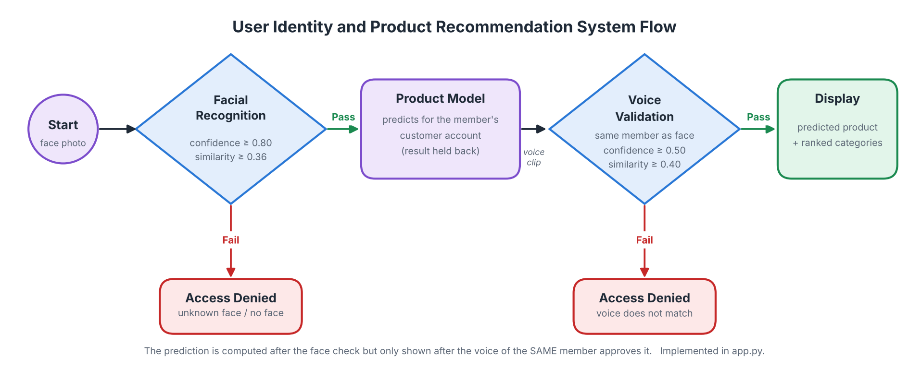

# Formative 2 - Multimodal Data Preprocessing

**Cohort 2, Team 26:** Alain, Arnold, Desire, Ivan

A user identity and product recommendation system. A user is recognised by their **face**, the product model predicts
what they are likely to buy, and the prediction is only shown after their **voice** confirms the transaction.



| | |
|---|---|
| Report | [Formative2_Multimodal_Processing_Report_Cohort2_Team26.pdf](reports/Formative2_Multimodal_Processing_Report_Cohort2_Team26.pdf) |
| Demo video | https://youtu.be/Q9iVa4_k5gY |
| Tracker sheet | [BSE Group Assignments : Task Sheet_ML-Pipeline_Formative 2 - Data Preprocessing_Cohort 2_Team26](https://docs.google.com/spreadsheets/d/1r_ei_06foCK3CT8ogSTeNYmN43004Tzc9u6T04i-z_o/edit?usp=sharing) |

## The assignment

1. Merge two customer datasets (social profiles and transactions) and build a model that predicts the product a
   customer will buy.
2. Collect face images (neutral, smiling, surprised) and voice samples ("Yes, approve", "Confirm transaction") from
   every member, augment them and extract features.
3. Train a facial recognition model, a voiceprint verification model and a product recommendation model.
4. Demonstrate the full flow in a command-line app, including unauthorised attempts.

## How we built it

- **Data merge:** cleaned both tables (duplicates, IDs, dates, missing ratings), aggregated the social profiles to one
  row per customer and left-joined them onto the transactions (150 rows, no rows lost).
- **Images:** detected and cropped each face, applied 7 augmentations (rotation, flip, grayscale, brightness, noise)
  and extracted colour histogram, LBP and HOG features (532 per image).
- **Audio:** trimmed each clip to the spoken phrase, applied 6 augmentations (pitch shift, time stretch, background
  noise, volume) and extracted MFCC, spectral roll-off, energy and other features (50 per clip).
- **Models:** Logistic Regression, Random Forest and XGBoost were compared for each task; Logistic Regression was
  selected for all three. Face and voice are only accepted when the model is confident **and** the sample is similar
  to that member's enrolled samples, which rejects strangers.

| Model | Accuracy | F1 | Log loss |
|---|---|---|---|
| Facial recognition | 0.917 | 0.914 | 0.177 |
| Voiceprint verification | 0.724 | 0.629 | 1.002 |
| Product recommendation | 0.243 | 0.224 | 1.698 |

## Repository contents

### Datasets – [`datasets/`](datasets)

| File | Description |
|---|---|
| [`merged_customer_recommendation_dataset.csv`](datasets/merged_customer_recommendation_dataset.csv) | Merged dataset with engineered features (150 rows × 21 columns) |
| [`image_features.csv`](datasets/image_features.csv) | Image features: 4 members × 3 expressions × 8 versions (96 rows) |
| [`audio_features.csv`](datasets/audio_features.csv) | Audio features: 14 recordings × 7 versions (98 rows) |
| `customer_social_profiles - customer_social_profiles.csv` | Raw social profiles |
| `customer_transactions - customer_transactions.csv` | Raw transactions |

### Python scripts – [`src/`](src) and [`app.py`](app.py)

| File | Purpose |
|---|---|
| [`app.py`](app.py) | Command-line app: face check → product prediction → voice check |
| [`src/face_model.py`](src/face_model.py) | Facial recognition model |
| [`src/voice_model.py`](src/voice_model.py) | Voiceprint verification model |
| [`src/product_model.py`](src/product_model.py) | Product recommendation model |
| [`src/verification.py`](src/verification.py) | Shared accept/reject logic for face and voice |
| [`src/image_pipeline.py`](src/image_pipeline.py) | Face detection, augmentation and image features |
| [`src/audio_pipeline.py`](src/audio_pipeline.py) | Speech trimming, augmentation and audio features |
| [`src/media_io.py`](src/media_io.py) | Reads any image or audio format |
| [`src/model_store.py`](src/model_store.py), [`src/environment.py`](src/environment.py) | Model saving and package setup |

Trained models are in [`models/`](models).

### Jupyter notebooks – [`notebooks/`](notebooks)

| Notebook | Content |
|---|---|
| [`Formative_2_Tabular_Data_Preprocessing.ipynb`](notebooks/Formative_2_Tabular_Data_Preprocessing.ipynb) | EDA, cleaning, merge and validation |
| [`Formative_2_Image_Processing.ipynb`](notebooks/Formative_2_Image_Processing.ipynb) | Face images, augmentation, image features |
| [`Formative_2_Audio_Processing.ipynb`](notebooks/Formative_2_Audio_Processing.ipynb) | Waveforms, spectrograms, augmentation, audio features |
| [`Formative_2_Models_and_System_Demo.ipynb`](notebooks/Formative_2_Models_and_System_Demo.ipynb) | The three models, evaluation and system simulation |

### Tracker sheet

[`BSE Group Assignments : Task Sheet_ML-Pipeline_Formative 2 - Data Preprocessing_Cohort 2_Team26`](https://docs.google.com/spreadsheets/d/1r_ei_06foCK3CT8ogSTeNYmN43004Tzc9u6T04i-z_o/edit?usp=sharing): team roles, task
allocation and meeting log.

### Other folders

| Folder | Content |
|---|---|
| [`data/images/`](data/images), [`data/audio/`](data/audio) | Each member's photos and voice recordings |
| [`data/unauthorized/`](data/unauthorized) | Photo and voice of a non-member, used for the unauthorised attempts |
| [`reports/`](reports) | Report and system flow diagram |
| [`video/`](video) | Demo video |

## How to run

```bash
git clone https://github.com/mutaganzwa-desire/multimodal_data_preprocessing.git
cd multimodal_data_preprocessing
pip install -r requirements.txt
```

```bash
python app.py --demo                              # authorised transaction + unauthorised attempts
python app.py                                     # interactive: enter a photo, then a voice clip
python app.py --face PHOTO --voice CLIP           # one transaction
```

On Google Colab, open any notebook from GitHub and select **Runtime → Run all**.
